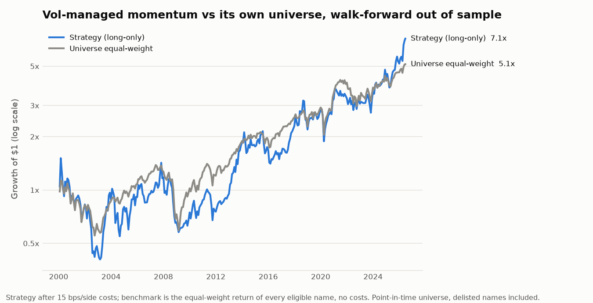
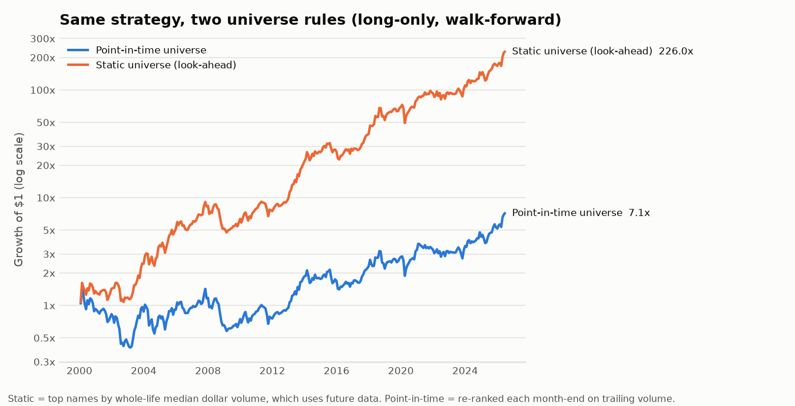
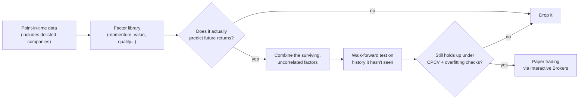
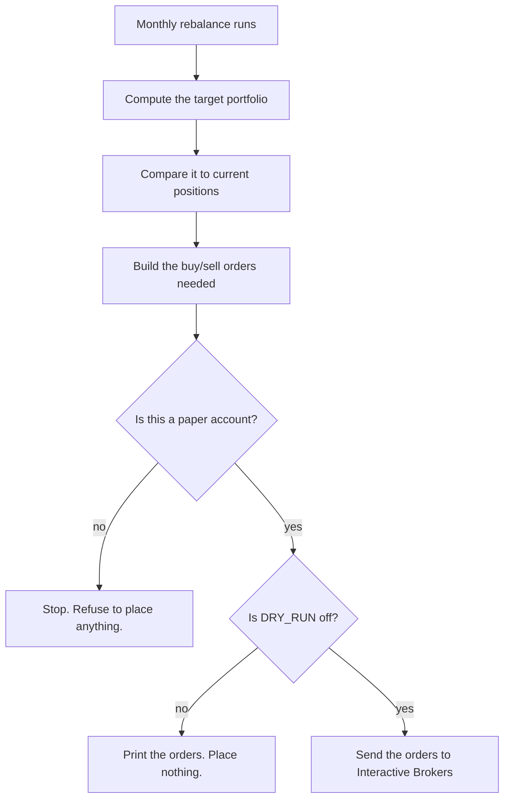
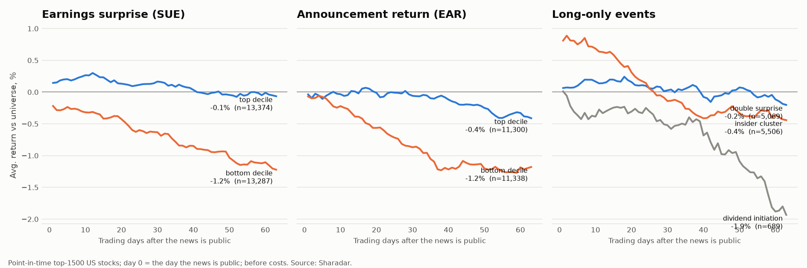

# pit-backtester


## What this is

Most backtests lie to you, usually by accident. A strategy can look great in a backtest
and still be worthless in real life, because the test used data that would not have been
available at the time, or because twenty ideas were tried and one happened to get lucky.

This project treats that as an engineering problem, not just a research problem.

- The price and fundamental data include companies that went bankrupt or got delisted,
  not just the ones still around today. Testing only on survivors makes every result look
  better than it really was.
- Which stocks count as "the universe" is decided month by month, using only trading
  volume up to that date. Picking the universe with hindsight (for example "the 1,500 most
  traded stocks over 2000-2026") quietly includes companies because of what they later
  became. Measured below, that one shortcut more than doubled this strategy's backtested Sharpe.
- Every factor (a formula meant to predict returns) is automatically tested to prove it
  never uses future data. This is not a comment in the code that says "trust me." It is a
  test that builds fake data, deletes the future half of it, and checks that the answer
  does not change.
- Strategies are checked on stretches of history they never saw during development
  (walk-forward testing), then checked again with a method called combinatorial purged
  cross-validation, which splits history into many different train and test combinations
  instead of just one.
- After that, two statistical checks called the Deflated Sharpe Ratio and the Probability
  of Backtest Overfitting ask a blunt question: given how many things were tried, how
  likely is it that this result is just luck?
- The strategy under test is intentionally simple: buy stocks with strong recent momentum,
  skip the most recent month to avoid short term reversals, and shrink the position size
  when volatility spikes. The goal of this project was never to find a secret formula. It
  was to build a system that can tell a small, real edge apart from noise, and the honest
  answer it gives for this strategy is: barely, and not enough to trade.

The last step connects to Interactive Brokers in paper trading mode (fake money, real
market data), with safety checks that make it very hard to place a live order by accident.

For the full walkthrough of how each piece works, read `ARCHITECTURE.md`.

## Results

All numbers come from `python main.py report`, which writes [`reports/RESULTS.md`](reports/RESULTS.md)
and the charts below. Walk-forward out of sample, January 2000 to June 2026, after 15 bps per
side of trading costs, on a point-in-time universe that includes delisted stocks.

| | CAGR | Sharpe | Max drawdown |
|---|---|---|---|
| Vol-managed momentum, long-only | +7.6% | 0.27 | -73% |
| Vol-managed momentum, long/short | +10.0% | 0.35 | -65% |
| Equal-weight universe (no costs) | +6.5% | 0.21 | -57% |



**What it means.** The strategy beats simply holding its own universe, but only slightly,
with much deeper drawdowns, in 5 of 9 three-year windows, and the gap disappears
at small-cap trading costs (40 bps per side: Sharpe 0.20 vs 0.21). The overfitting checks say the result
is not a product of the search (PBO 7%), but a real-and-tiny edge is still not a tradeable
one. It stays in paper trading.

**The biggest finding was a bug in my own pipeline.** The first version picked the universe
by each stock's median trading volume over its *whole life*, so a company that was small in
2000 and huge by 2020 was "in the universe" in 2000. Fixing that one line of reasoning:

| Universe rule | Long-only Sharpe | Long-only CAGR |
|---|---|---|
| Whole-life liquidity (look-ahead) | 0.72 | +22.5% |
| Point-in-time, same number of eligible stocks | 0.31 | +9.2% |
| Point-in-time, default size | 0.27 | +7.6% |



The size-matched row matters: the two rules give universes of different breadth, so the
middle row holds breadth fixed to show the drop comes from the look-ahead itself. The
fix is in `backtest/universe.py` (`point_in_time_membership`), with a property test that
deletes all future data and checks that membership does not change.

## How it fits together



Every order placed by the paper trading step goes through the same safety checks:



## Platform core: any signal, any asset class

The project is growing from one strategy into a multi-asset research platform (US stocks,
China commodity futures, A-shares next). Seven shared drivers in `core/` make that possible:

| Driver | What it does |
|---|---|
| `core/dataset.py` | One `Dataset` per asset class: price panels, a point-in-time investable universe, trading costs |
| `core/signals.py` | One registry for every factor: its source, family, publication year, and the direction the source predicts, all fixed *before* it is tested |
| `core/evaluate.py` | The same monthly test for every signal: rank IC plus a cost-aware long-short, split by halves and before/after publication |
| `core/alpha.py` | Combines all of an asset class's signals into one score, fit walk-forward only: equal weight, IC-weighted, ridge, XGBoost |
| `core/portfolio.py` + `core/design.py` | Turns a score into a book (long-short, long-only top-N, time-series; buffer, sector-neutral, vol target), simulates it with drifting holdings and costs, and searches the design space with a walk-forward selector |
| `core/allocation.py` | Combines books (risk parity / 50-50 / shrunk max-Sharpe, walk-forward) and sets leverage from a drawdown limit |
| `core/trials.py` | An append-only log of every test ever run (`research/trials.jsonl`, committed), with Benjamini-Hochberg multiple-testing correction computed from it |

```
python main.py evaluate cn_futures        # every registered futures signal, logged and corrected
python main.py evaluate us_equity         # every registered US equity factor
python main.py alpha us_equity            # walk-forward combinations vs the best single signal
python main.py design us_equity           # every pre-registered portfolio configuration + the selector
```

Testing hundreds of factors guarantees some false positives, so nothing counts as a finding
unless it survives correction over *everything* in the log, including the failures.

**First alpha-model result: no combination passed.** The bar, written down before the first run:
a combination's out-of-sample Sharpe must beat the best single signal *and* the equal-weight
blend in each half of the test period, with the best single picked after the fact in each half.

| Out-of-sample net Sharpe | US stocks, 24 signals (2001–2026) | China futures, 6 signals (2013–2026) |
|---|---|---|
| Equal weight | 0.30 | **0.77** |
| IC-weighted | 0.21 | 0.53 |
| Ridge | 0.24 | 0.60 |
| XGBoost | **0.53** (0.52 / 0.53 by half) | 0.49 |
| Best single signal (whole period) | 0.55 (FCF yield) | 0.66 (RANK63) |
| Best single, chosen per half | 0.99 / 0.73 | 0.76 / 0.80 |

Equal weight is the best futures portfolio overall but loses the second half to a trend
signal chosen in hindsight. XGBoost is the steadiest US combination but doesn't beat
the best single factor. IC-weighting and ridge likely underperform because a high IC doesn't
mean high profit after costs: low-volatility and idiosyncratic-volatility factors have the highest
US rank ICs but weak net long-short returns.

**Portfolio construction: 160 configurations, judged by a selector that only sees the past.**
Each configuration is one choice per layer: score source × portfolio type × sector-neutral or
not × turnover buffer (or rebalance speed) × vol target. All 160 were run and logged. The
number that counts comes from a selector that switches each year to whichever configuration
has the best record *so far*, measured on months it hadn't seen. The bar was written down
before the first run: the selector must beat the plain default in both halves, and PBO must
be ≤ 0.5.

| Track (OOS window) | Plain default | Walk-forward selector | PBO | Verdict |
|---|---|---|---|---|
| US long-short (2002–2026) | 0.26 | **0.83** (1.02 / 0.63 by half) | 0.00 | **selector adopted**: XGBoost score, sector-neutral, vol-targeted |
| US long-only (2002–2026) | **0.72** (universe: 0.49) | 0.73 (0.72 / 0.741 vs 0.743) | 0.13 | plain default kept: equal-weight score, top 50 |
| China futures (2015–2026) | **0.70** | 0.74 (1.16 / 0.35) | 0.59 | plain default kept: equal-weight score, time-series, monthly |

Simple won two of three tracks. Averaging every signal beat choosing among them in long-only
US and in futures. The one place complexity paid is the US long-short book, where XGBoost
plus sector neutrality plus a vol target holds up out of sample. That book can't go in a cash
account: it needs shorting, and borrow and financing costs are not modeled yet.

**Putting it together: two uncorrelated books.** The US long-short book, now charged 0.5%/yr
short borrow and a 0.5%/yr financing spread, and the China futures book are almost
uncorrelated (+0.04, 2014–2026). Weighting them by inverse volatility, using only past
data, beats each book alone in both halves:

| 2014-05 → 2026-06, after all costs | Sharpe | CAGR over cash | Max drawdown |
|---|---|---|---|
| US long-short book | 0.54 | 4.5% | −27.3% |
| China futures book | 0.72 | 4.5% | −9.4% |
| **Risk-parity combination** | **0.88** (0.88 / 0.87 by half) | 4.7% | −5.7% |
| …levered to a 10% vol target | 0.83 | 8.6% | −13.1% |
| …15% target | 0.83 | 12.7% | −20.0% |
| …4× leverage cap (25% target, the drawdown rule's pick) | 0.88 | 17.9% | −24.1% |

The leverage rule picks the highest target whose bootstrapped 10-year drawdown stays within
35%. It chose the top setting, which runs into the 4× cap. Under a 1.5%/yr borrow-cost stress
it picks 15% instead. The leverage assumes institutional portfolio margin, and most China
futures aren't open to foreign retail accounts. Treat this as a property of the strategy,
not a deployable plan.

**US event-driven signals (E1): none survive in liquid US stocks.** Five classic event
signals were tested as weekly long-only portfolios, net of costs, against the equal-weight
universe: earnings surprise (SUE), the 3-day earnings-announcement return, a "double surprise"
of both, insider purchase clusters, and dividend initiations.

| Signal (since) | Excess return / yr | IR (h1 / h2) | Long−short IR |
|---|---|---|---|
| Earnings surprise, top decile (1999) | +0.2% | 0.03 (0.02 / 0.06) | 0.19 |
| Announcement return, top decile (2004) | −0.8% | −0.12 (0.00 / −0.21) | 0.27 |
| Double surprise (2004) | −0.6% | −0.09 | — |
| Insider purchase cluster (2008) | −4.6% | −0.54 | — |
| Dividend initiation (2000) | −9.8% | −0.46 | — |



The chart shows why. In the 1,500 most liquid US stocks, good news is priced almost
immediately: the top deciles drift to about zero. Insider buying shows up as a +0.8% jump the
day after the filing, which a weekly rebalance can't catch. Bad news still drifts (bottom
deciles −1.2% over three months), but profiting from that requires shorting. This matches the
published finding that post-earnings drift has mostly disappeared outside small, illiquid stocks.


The futures pipeline is a pandas port of a DolphinDB research lab and is checked against it:
`research/reconcile_futures.py` shows the continuous-contract panel (157,395 rows) and the
daily P&L of all six ported futures strategies identical to floating-point precision.

## Prerequisites

- Python 3.11 or higher
- An Interactive Brokers paper trading account, with TWS or IB Gateway running locally and
  the API enabled (Global Configuration > API > Settings), needed for the `paper` command
- A Nasdaq Data Link (Sharadar) API key for the point-in-time data. Some commands still
  work without one, using free data instead. See `ARCHITECTURE.md`, Chapter 5.

## Setup

1. Clone the repo and move into it:
   ```
   git clone <your-repo-url>
   cd pit-backtester
   ```

2. Create and activate a virtual environment:
   ```
   python -m venv venv
   source venv/bin/activate      # Mac/Linux
   venv\Scripts\activate         # Windows
   ```

3. Install dependencies:
   ```
   pip install -r requirements.txt
   ```

4. Set up your environment variables:
   ```
   cp .env.example .env
   ```
   Then open `.env` and fill in your real keys. Never commit `.env`.

5. Build the offline Sharadar archive once (needs `NASDAQ_DATA_LINK_API_KEY`; every command
   after this runs with zero API calls):
   ```
   python data/archive_sharadar.py
   ```

## Running

`main.py` is the single entry point, with ten subcommands:

```
python main.py factors                          # test each factor for predictive power
python main.py altdata                           # test insider/institutional signals vs momentum
python main.py strategy vol_managed_momentum     # backtest, walk-forward, and overfitting checks
python main.py report                            # regenerate reports/ (tables + charts), ~10 min
python main.py evaluate us_equity                # every registered signal, logged to research/trials.jsonl
python main.py alpha us_equity                   # walk-forward signal combinations, logged as trials
python main.py design us_equity                  # P3 design space + walk-forward selector (~15 min)
python main.py allocate                          # P5: combine books + leverage dial (~15 min)
python main.py events                            # E1: US event signals + the drift chart (~10 min)
python main.py paper vol_managed_momentum        # one monthly paper rebalance (needs TWS/IB Gateway)
```

`VMM_LONG_ONLY=true` switches `strategy` to the long-only variant (the one paper traded), and
`UNIVERSE_MODE=static` reruns anything on the old look-ahead universe for comparison.

Add `--no-broker` to `paper` for an offline preview that computes the target portfolio and
orders without connecting to anything.

## Testing

The core math and the safety checks are covered by an offline, deterministic pytest suite.
Nothing in it touches the network. Install the dev dependencies and run it:

```
pip install -r requirements-dev.txt
pytest
```

What's covered:

- **factors/** - the tests that check whether a factor predicts anything, plus an automatic
  check (`tests/test_no_lookahead.py`, using `hypothesis`) that proves every registered
  factor never uses future data. It works by generating random fake data, deleting
  everything after a cutoff date, and confirming each factor's value at that date does not
  change. This runs for many random seeds and symbol counts, not just one example.
- **backtest/universe.py** - the point-in-time universe: a stock that becomes liquid later is
  not eligible earlier, delisted stocks drop out on their last day, and a `hypothesis`
  property test proves that deleting every bar after a date never changes membership before
  it. (The test was checked by planting a look-ahead and watching it fail.)
- **strategies/** - the momentum strategy and the alternate versions it was tested against.
- **research/report.py** - the stitched walk-forward path, the universe benchmark, and an
  end-to-end render of the report on synthetic data.
- **research/cpcv.py** - the math behind the overfitting checks: the split counts come out
  right, and the statistics give the expected answer on made-up data where the right answer
  is already known.
- **decision/** - the logic that turns a target portfolio into real buy and sell orders.
- **safety checks** - the rules that block real trades unless the account is a paper
  account and `DRY_RUN` is off. These are tested against a fake broker, so nothing here
  ever opens a real connection.

CI (`.github/workflows/ci.yml`) lints with `ruff` and runs the full offline suite with
coverage on Python 3.11, 3.12 and 3.13 on every push and pull request.

## Project structure

```
pit-backtester/
  config.py          # settings: autonomy_mode, risk params, ports, keys from env
  data/              # point-in-time data (Sharadar) + the provider interface
  factors/           # factor library, predictive-power tests, evaluation scripts
  research/          # factor-combination, crash-fix, overfitting checks, results report
  strategies/        # the strategy that survived validation (vol-managed momentum)
  backtest/          # universes, walk-forward validation, benchmarks, risk metrics
  decision/          # the safety gate + the paper-rebalance runner
  execution/         # Interactive Brokers connection wrapper
  core/              # shared drivers: datasets, signal registry, evaluator, trial registry
  storage/           # sqlite layer (paper rebalance / target / order history)
  reports/           # generated by `main.py report`: RESULTS.md, results.json, charts
  main.py
```

See `ARCHITECTURE.md`'s "Map of the repository" for what each file does.

## Safety

- The `paper` command talks to an IBKR paper account. Port 7497 is paper, 7496 is live.
  This project has never placed a live order and is not meant to.
- Never commit API keys or your `.env` file.

## Status

Complete as a research and validation platform. Every command under "Running" works end
to end, offline, against the local Sharadar cache, and every result quoted in this README
is regenerated by `main.py report`. The strategy itself is not good enough to trade with
real money, which is the finding, not a gap. See `ARCHITECTURE.md`'s "Honest limitations"
for what the system cannot do.
