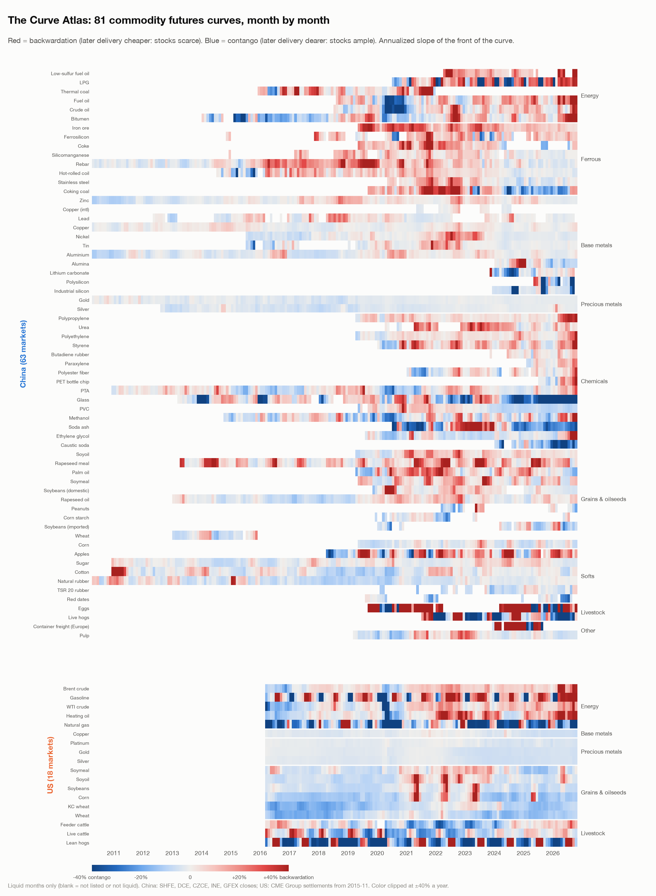
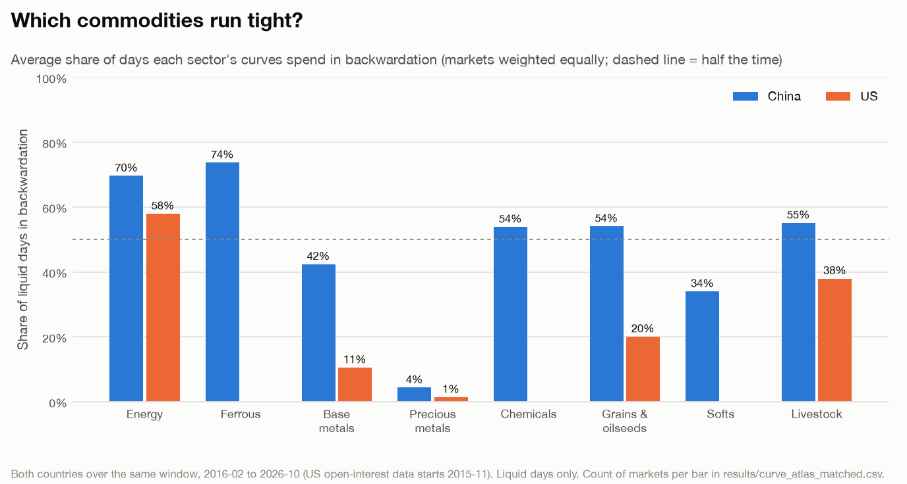
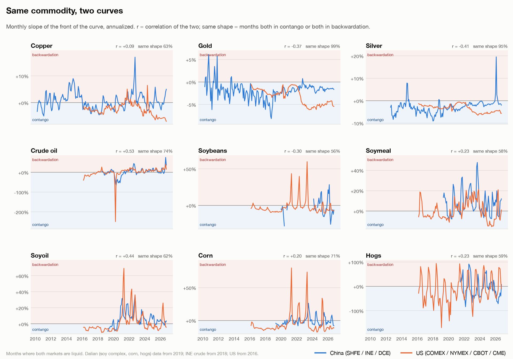
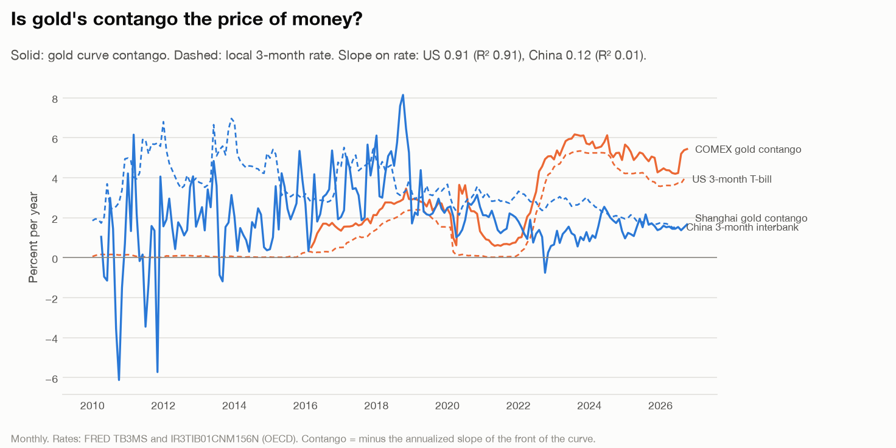
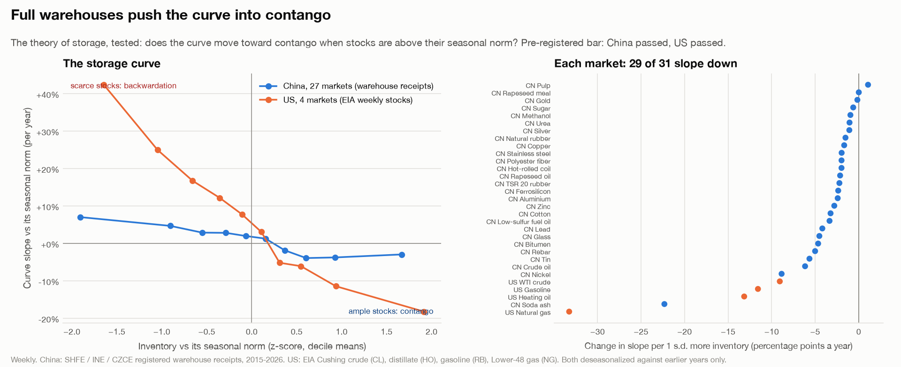
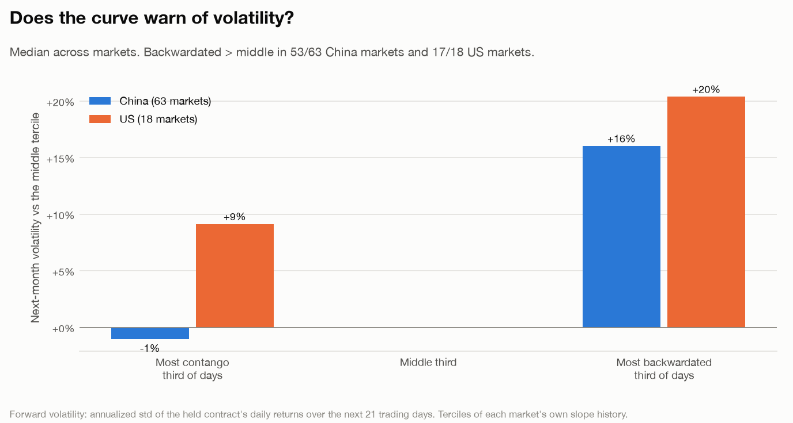
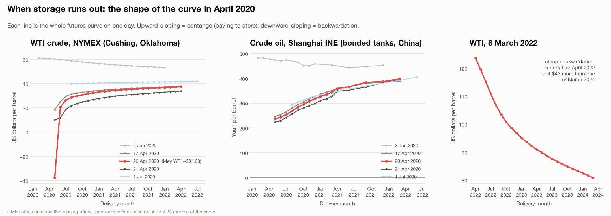
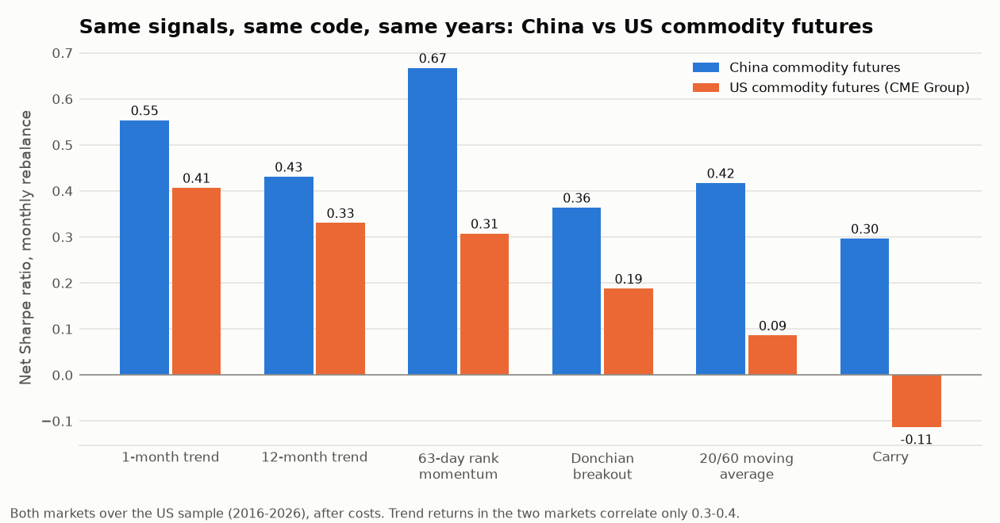
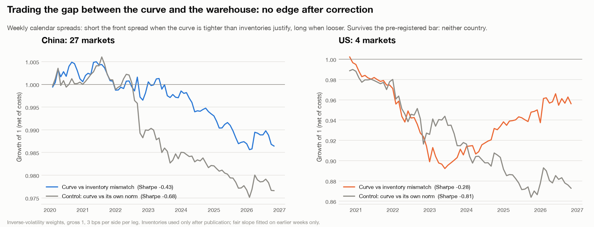

# ContangoLab


**What futures curves say about commodity markets, measured the same way in China and the US.**

A futures curve prices one commodity for delivery at different dates. Its slope says what the
physical market is short of:
- **Contango:** later months cost more. Stocks are ample, and the spread pays someone to store.
- **Backwardation:** later months cost less. Stocks are scarce, and the market pays for delivery now.

ContangoLab builds those curves from raw exchange records for **95 commodity markets on 9
exchanges**:
- **China:** Shanghai (SHFE), Dalian, Zhengzhou, INE and Guangzhou;
- **US:** NYMEX, COMEX, CBOT and CME.

It then tests what moves them, and whether trading them pays. Every test's rules were committed
to git before it was run.



## Key findings

| | Finding | Evidence |
|---|---|---|
| 1 | **Inventories set the shape of the curve.** When stocks are above their seasonal norm, the curve moves toward contango, as the theory of storage predicts. | 25 of 27 China markets (warehouse receipts) and all 4 US energy markets (EIA stocks). Pre-registered test passed in both countries (sign test p = 3×10⁻⁶). |
| 2 | **A backwardated curve warns of volatility.** With no inventory buffer, shocks hit price. | Next-month volatility runs 16% (China) and 20% (US) above normal in the most backwardated third of days, in 53 of 63 and 17 of 18 markets. |
| 3 | **China's curves run tighter than America's.** Same years, very different storage economics. | Backwardated on 54% vs 20% of days in grains, and on 42% of days in Chinese base metals vs 11% for US copper. Chinese iron ore: 99% of days. |
| 4 | **Gold's US curve is an interest rate.** COMEX gold contango tracks the 3-month T-bill almost one-for-one. Shanghai's does not, so the pre-registered test failed. | US slope 0.91, R² 0.91. China slope 0.12, R² 0.01. |
| 5 | **Trading the curve did not pay in the US.** Trend and momentum survive multiple-testing correction in China, but nothing does in the US. Carry lost money, short crude into the 2020 rebound. | China: 5 of 6 signals survive (best Sharpe 0.66). US: 0 of 8. 222 tests logged and corrected together. |
| 6 | **When the curve and inventories disagree, the gap does not close within a week.** Calendar spreads betting on the curve snapping back to its inventory-implied level lost money in both countries. | Net Sharpe −0.43 (China, 27 markets) and −0.28 (US, 4 markets). Pre-registered test failed. |

## 1. The Curve Atlas

Each row of the heatmap above is one market's curve slope, month by month: red is
backwardation and blue is contango.



**What the atlas shows:**
- **Precious metals** are almost never backwardated: 1% of days in the US, 4% in China. Their
  curves only reflect the cost of financing the metal.
- **Energy** flips with the cycle. US energy curves were backwardated on 10% of days in 2016 and
  22% in 2020, then 75% in 2021 and 86% in 2022.
- **China's ferrous complex** (iron ore, coke, rebar) is backwardated three days in four.

## 2. Same commodity, two curves

Nine commodities trade in both countries. Their curves usually agree on contango vs
backwardation, but they rarely move together.



- **Crude oil** is the most closely linked pair (correlation 0.53).
- **Gold and silver** move in *opposite* directions (−0.37 and −0.41), even though both are in
  contango 95–99% of months. The reason is money:
  - a gold curve's slope is the cost of financing the metal;
  - from 2022, US rates rose from near zero to about 5% while Chinese rates drifted down.
  - The gap between the two gold curves tracks the gap between the two interest rates
    (correlation 0.86).



## 3. Do full warehouses flatten the curve?

This is the theory of storage (Kaldor 1939, Working 1949, Brennan 1958) tested on two
countries' inventory data:
- **China:** weekly warehouse receipts on the Shanghai, INE and Zhengzhou exchanges, 2015–2026.
- **US:** EIA weekly stocks. Cushing crude pairs with WTI, distillate with heating oil, gasoline
  with gasoline futures, and Lower-48 gas storage with Henry Hub natural gas.

**Method:**
- Both inventories and slopes are measured against their own seasonal norm, using earlier years
  only.
- The regression uses Newey–West standard errors.



**Results:**
- The effect has the predicted sign in 29 of 31 markets.
- In China the curve is **steep when stocks are scarce and flat when they are full**. That is the
  asymmetry the theory predicts: contango is capped by the cost of storage, backwardation is not.

## 4. Does the curve warn of volatility?



## 5. April 2020: when storage ran out

On 20 April 2020 the May WTI contract settled at **−$37.63**. Its delivery point, Cushing,
Oklahoma, was nearly full, and holders paid to avoid taking oil they could not store. Shanghai's
crude contract, deliverable into bonded tanks in China, stayed in ordinary contango through the
same days.



## 6. Does trading the curve pay?

The same signals run on both countries through one engine:
- monthly rebalance;
- net of costs;
- corrected for multiple testing over every test ever logged.



| Signal | US net Sharpe (first / second half) | q (all trials) | China, same years |
|---|---|---|---|
| 1-month trend | 0.41 (0.42 / 0.39) | 0.13 | 0.55 |
| 12-month trend | 0.33 (0.15 / 0.53) | 0.19 | 0.43 |
| Basis-momentum (Boons & Prado 2019) | 0.32 (−0.33 / 0.77) | 0.20 | — |
| 63-day rank momentum | 0.31 (0.30 / 0.32) | 0.20 | 0.67 |
| Donchian breakout | 0.19 (0.37 / −0.01) | 0.31 | 0.36 |
| 20/60 moving average | 0.09 (0.16 / −0.00) | 0.43 | 0.42 |
| Hedging pressure, CFTC (Basu & Miffre 2013) | −0.05 (−0.02 / −0.07) | 0.61 | — |
| Carry: long backwardation, short contango | −0.11 (−0.72 / 0.42) | 0.69 | 0.30 |

**US:** no signal clears the bar (q ≤ 0.10 and positive in both halves).
- **Carry** was short crude, gasoline and heating oil at the deepest contango of spring 2020;
  they rallied 19–45% in May.
- **Trend** is positive but cannot be told apart from luck in ten years of US data.

**China:**
- Trend and momentum survive: 5 of 6 signals.
- An equal-weight blend of the six signals earns an out-of-sample net Sharpe of 0.77 over
  2013–2026.
- A 32-configuration portfolio search was kept out:
  - its walk-forward pick lost to that plain default in the second half;
  - its Probability of Backtest Overfitting was 0.59.

## 7. Can you trade the gap between the curve and the warehouse?

Section 3 gives a "fair" slope for any level of inventory. When the curve is tighter than
inventories justify, does it relax, and can a calendar spread (long the front month, short the
next, or the reverse) earn that?

**Setup:**
- Weekly calendar spreads in the 31 markets with inventory data.
- Inventories are used only after publication.
- The fair slope is fitted on earlier weeks only.
- A control makes the same bet without inventories.



**It doesn't work.** Net Sharpe was −0.43 in China and −0.28 in the US, and both failed the
pre-registered bar.

At a one-week horizon, a curve that is out of line tends to *stay* out of line. The pure curve
control loses even more. That fits the evidence that spreads trend (Boons & Prado 2019). The
opposite bet is not claimed: it would need its own pre-registered test. Details are in
[`cl2-results.md`](docs/protocols/cl2-results.md).

## Why the numbers can be trusted

- **Rules first.** Each study's hypotheses, measures and pass bars are committed before it runs:
  - the curve studies: [`docs/protocols/cl1-curve-studies.md`](docs/protocols/cl1-curve-studies.md);
  - their results, including the expectations that missed:
    [`cl1-results.md`](docs/protocols/cl1-results.md);
  - the mismatch trade's rules and results: [`cl2-mismatch.md`](docs/protocols/cl2-mismatch.md),
    [`cl2-results.md`](docs/protocols/cl2-results.md).
- **Every trial counts.** All 222 trading tests are in `results/trials.jsonl`, including failures
  and the abandoned US equity work. Benjamini–Hochberg q-values are computed over all of them.
- **No future data:**
  - the contract held today is chosen with yesterday's open interest;
  - CME open interest is used a day late, as it is published;
  - CFTC reports are used a week after their date, later around government shutdowns;
  - seasonal norms use earlier years only.
- **Exchange-grade prices.** US prices are CME's official settlements, so every month on a curve
  is priced at the same moment.
- **The data was audited.**
  - **CME feed error:** a record dated the wrong day made 17 April 2020 read −$37.63 instead of
    $18.27. The fix is tested, and the earlier results were rerun and are unchanged.
  - **Settlement flags:** CME changed how it flags final settlements in 2016–17. Both formats
    are handled, and where both exist they agree on 100% of 1.6M contract-days.
- **Reconciled.** The China pipeline reproduces an independent DolphinDB research build exactly:
  157,395 contract-days and six strategies' daily P&L, to floating-point precision.

## Layout

```
contangolab/
  markets/   exchange records -> continuous contracts and curves
             china.py, cme.py, cftc.py, databento.py, curves.py, inventory.py
  signals/   trading-signal library and registry (fixed signs, sources, publication years)
  engine/    datasets, the shared monthly test, trial log, walk-forward combination,
             portfolio simulation, design-space search, Deflated Sharpe / PBO
  studies/   one module per question: atlas, twins, storage, volatility, cases, mismatch, cross_market
results/     every chart and table above, plus trials.jsonl
docs/        pre-registrations and results
tests/       87 offline tests on synthetic markets (look-ahead, accounting, statistics)
```

## Running

```bash
pip install -e ".[dev]"
python -m contangolab study all                 # every chart and table in results/
python -m contangolab study storage             # one study
python -m contangolab evaluate cn_futures       # trading signals, logged as trials
python -m contangolab trials                    # the full trial log with corrected q-values
pytest                                          # offline, no data needed
```

**Data:**
- **China:** daily per-contract bars and warehouse receipts from the exchanges' public data,
  pulled with akshare (set `FUTURES_CN_DIR`).
- **US:** CME settlements from Databento (`python -m contangolab.markets.databento`, needs
  `DATABENTO_API_KEY`). Every pull is quoted and capped before spending.
- **Public series:** EIA stocks and FRED rates (`python -m contangolab.markets.inventory`).

Databento data is licensed and stays in the git-ignored `data/cache/`. Only charts and summary
statistics are published.

## History

This repository began in June 2026 as **pit-backtester**, a point-in-time US equity backtester
with:
- survivorship-free data;
- walk-forward and purged cross-validation;
- an Interactive Brokers paper-trading path.

Its honest verdict was that momentum's edge was too thin to trade. The research then moved to
commodity futures, and the equity code was removed in October 2026. That code is preserved in
this repository's history (tag `equity-final`), and its trials remain in the log.

MIT license.
