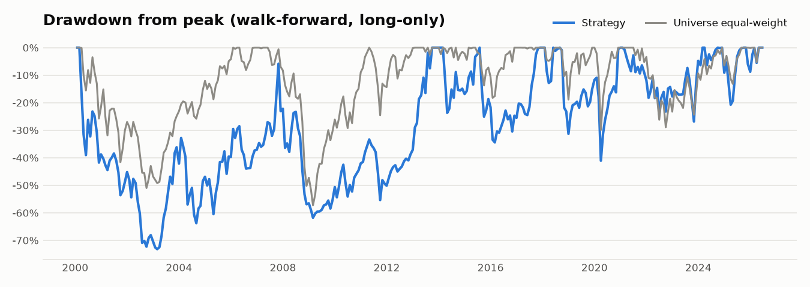
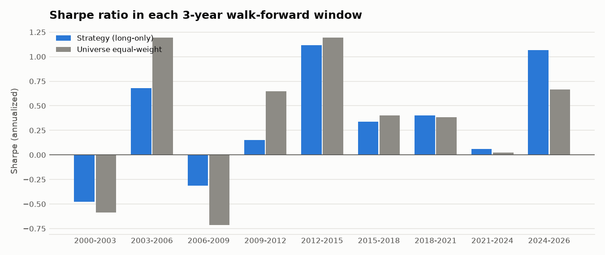
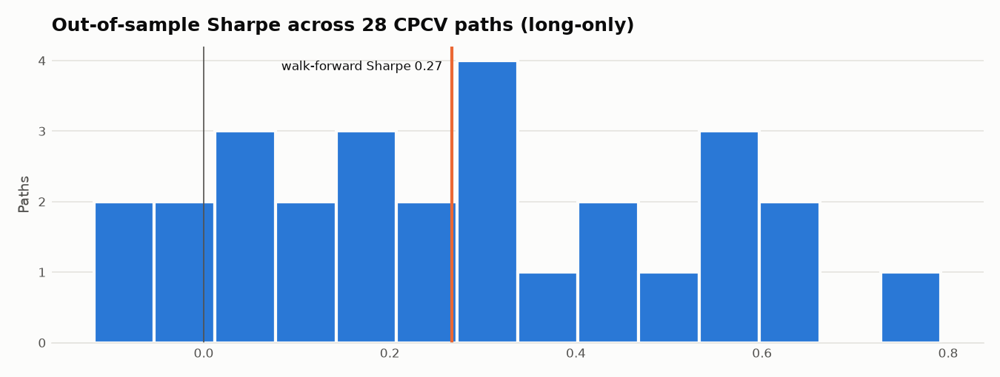

# Results

Generated 2026-10-10 by `python main.py report` from the local Sharadar archive. Every figure here is written by `research/report.py`; none is typed by hand.

Universe: the top 1,500 US common stocks by trailing 3-month dollar volume, re-ranked at every month-end using only data available that day (delisted names included), then filtered to price >= $5 and 20-day ADV >= $5M. Costs: 15 bps per side on actual turnover. Returns are the stitched walk-forward out-of-sample path, 2000-01-31 to 2026-06-18.

## Headline (walk-forward, after costs)

| Series | CAGR | Vol | Sharpe | Sortino | Max DD |
|---|---|---|---|---|---|
| Vol-managed momentum, long-only | +7.6% | 31.5% | 0.27 | 0.40 | -73.2% |
| Vol-managed momentum, long/short | +10.0% | 30.7% | 0.35 | 0.51 | -64.8% |
| Universe equal-weight (no costs) | +6.5% | 20.0% | 0.21 | 0.30 | -57.3% |

## Walk-forward windows (long-only)

| Window | Strategy Sharpe | Universe EW Sharpe | Strategy CAGR | Strategy max DD | Beat EW? |
|---|---|---|---|---|---|
| 2000-2003 | -0.48 | -0.59 | -25.3% | -72.3% | yes |
| 2003-2006 | 0.68 | 1.20 | +31.1% | -46.1% | no |
| 2006-2009 | -0.31 | -0.71 | -15.3% | -54.2% | yes |
| 2009-2012 | 0.15 | 0.65 | +7.0% | -33.0% | no |
| 2012-2015 | 1.12 | 1.19 | +31.2% | -23.7% | no |
| 2015-2018 | 0.34 | 0.40 | +9.1% | -34.4% | no |
| 2018-2021 | 0.40 | 0.38 | +7.4% | -41.1% | yes |
| 2021-2024 | 0.06 | 0.02 | -1.7% | -26.8% | yes |
| 2024-2026 | 1.07 | 0.67 | +35.1% | -20.7% | yes |

Positive Sharpe in 7/9 windows; higher Sharpe than the equal-weight universe in 5/9.

## The universe look-ahead, measured

Before this fix the universe was the 1,500 names with the highest *whole-life* median dollar volume. That quietly selects companies for what they later became. Same strategy, same code, only the universe rule changed.

The two rules also give different breadth: on a typical month-end the static list had only 733 eligible names (many of its picks had not listed or grown liquid yet), the point-in-time top 1,500 had 1432. So a third row uses a point-in-time top 750 (728 eligible names), sized to match the static list, to separate the look-ahead from the breadth.

| Universe | Median eligible names | Long-only Sharpe | Long-only CAGR | Long/short Sharpe | Long/short CAGR |
|---|---|---|---|---|---|
| Static top 1,500 (look-ahead) | 733 | 0.72 | +22.5% | 0.42 | +12.6% |
| Point-in-time top 750 (size-matched) | 728 | 0.31 | +9.2% | 0.33 | +9.5% |
| Point-in-time top 1,500 (default) | 1432 | 0.27 | +7.6% | 0.35 | +10.0% |

## Cost sensitivity (walk-forward)

| Cost per side | Long-only Sharpe | Long-only CAGR | Long/short Sharpe | Long/short CAGR |
|---|---|---|---|---|
| 5 bps | 0.29 | +8.5% | 0.41 | +12.0% |
| 15 bps | 0.27 | +7.6% | 0.35 | +10.0% |
| 40 bps | 0.20 | +5.2% | 0.20 | +5.1% |

Annual one-way turnover of the long book: ~367%.

## Is it luck? CPCV, Deflated Sharpe, PBO

| | Long-only | Long/short |
|---|---|---|
| CPCV paths with positive Sharpe | 25/28 | 23/28 |
| CPCV median path Sharpe | 0.26 | 0.39 |
| Deflated Sharpe vs the 6 configurations searched | 94% (bar 0.08) | 98% (bar 0.08) |
| Deflated Sharpe vs CPCV path dispersion (stricter) | 29% (bar 0.50) | 21% (bar 0.64) |

Probability of Backtest Overfitting across the 5 pre-registered momentum variants (70 CSCV splits): **7%**.

The Deflated Sharpe is the probability that the true Sharpe beats the best you would expect from luck alone given the search. Read 95%+ as convincing, under 50% as "can't tell from noise." The stricter row treats every CPCV path as a separate attempt, which overstates the search but shows how much of the result is sampling noise.

What the high first-row number does *not* say: it tests the Sharpe against a luck bar near zero, not against the market. Holding the equal-weight universe clears that bar too. The question that matters for deployment is the headline table: after costs the strategy's Sharpe is only slightly above the universe's, with deeper drawdowns.

